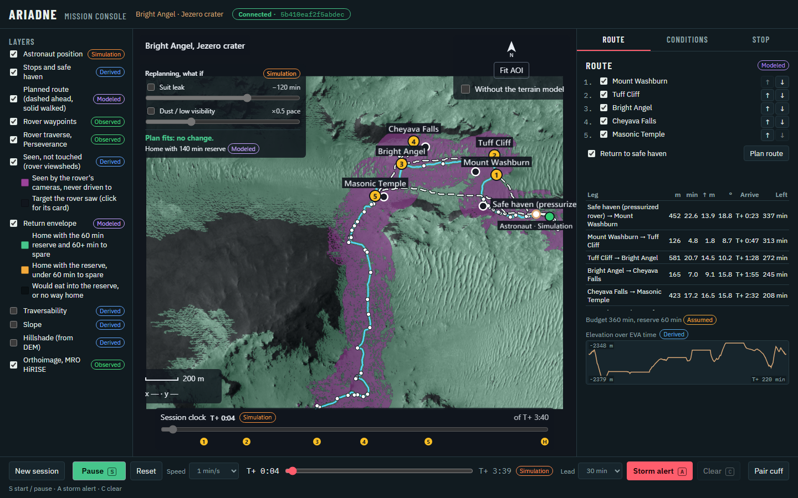

# Ariadne

## What it is

Ariadne is a walking-scale Mars EVA map for Bright Angel in Jezero crater. It layers NASA data,
plans a science walk, and shows at every moment whether the astronaut can still get back to the
safe haven. A mission console and a phone worn as a wrist cuff share one clock, so both see the
same margin to home. Built for NASA Space Apps 2026 by team Scirocco.



*The mission console on the live site, captured by the end-to-end test (`e2e/`) on 14 Nov 2026.*

## Live demo

- **Mission console:** https://ariadne-gilt-tau.vercel.app
- **Wrist cuff:** press **Pair cuff** on the console and scan the QR code with a phone.
- **DEMO replay:** https://ariadne-gilt-tau.vercel.app/?demo=1 needs no services. It replays the
  SYNTHETIC fixtures in `contracts/fixtures/` and shows a "DEMO DATA" badge.

The web app is on Vercel. Planner, mission-control and the map assets run with Docker and Caddy on
a Hetzner Cloud server (`infra/`).

## How it works

Three parts talk through the contracts in [`contracts/`](contracts/) (`openapi.yaml`, `aoi.json`,
WebSocket messages):

- **pipeline** (Python, GDAL): crops the HiRISE orthomosaic and DTM to a 2.5 x 2 km area. It
  computes slope, go / caution / no-go ground, walking cost and the minutes home from every 2 m
  cell, using one shortest-path run from the safe haven.
- **planner** (Python, FastAPI): `/route` plans a walk through the stops; `/abort` gives the way
  home from any point.
- **mission-control** (Go, Fiber): runs the walk simulation, streams the state to both screens over
  WebSocket twice a second, raises and clears storm alerts, and serves the conditions (MEDA
  weather, a radiation value, NASA DONKI forecasts).
- **web** (TypeScript, React, deck.gl): the mission console (`/`) and the cuff (`/cuff`). The return
  envelope is computed in the browser: margin = budget − elapsed time − reserve − minutes home.
  A "Without the terrain model" switch redraws it from flat-ground costs and shows how much of the
  site is still reachable either way. Two what-if controls (a suit leak, dust) trigger
  receding-horizon replanning: the console suggests shorter stops or a skipped stop that keeps the
  reserve, and the crew decides.

All positions are metres in a local plane (x east, y north, from the AOI south-west corner). Every
value on screen carries a provenance label: Observed, Derived, Modeled, Assumed or Simulation.

## Run locally

Requirements: Node 22+, Python 3.11+, Go 1.23+ (or Docker for the services).

```bash
# planner (port 8000)
cd planner && python -m venv .venv
. .venv/Scripts/activate        # Windows; source .venv/bin/activate elsewhere
pip install -r requirements-dev.txt
uvicorn app.main:app --reload --port 8000

# mission-control (port 8080)
cd mission-control && go run .

# web (port 5173; proxies /api/planner, /api/mc and /ws to the two services)
cd web && npm install && npm run dev
```

- **Services in Docker instead:** `docker compose -f infra/docker-compose.yml up -d --build` runs
  planner, mission-control and Caddy. Without an `infra/.env` it serves the SYNTHETIC fixtures; see
  [`infra/CLAUDE.md`](infra/CLAUDE.md) for the real assets.
- **DEMO mode, no services:** `cd web && npm run dev`, then open http://localhost:5173/?demo=1 (or
  set `VITE_DEMO=1`).
- **Real assets:** the services read the files listed in `contracts/aoi.json` from `DATA_DIR`. The
  pipeline in [`pipeline/`](pipeline/) builds them from the USGS HiRISE products, and
  `pipeline/scripts/07_bundle.sh` packs them.

Checks: `python contracts/check.py`, `cd web && npm run check`, `cd planner && python -m pytest`,
`cd mission-control && go vet ./... && go test ./...`. The end-to-end test of both screens through
the storm alert is in [`e2e/`](e2e/) (Playwright).

## Data sources

Every value and its source is a row in [`docs/DATA_SOURCES.md`](docs/DATA_SOURCES.md). Values
without a published source are marked Assumed. The main sources:

| Dataset | Agency | What it drives in the app | Provenance |
|---|---|---|---|
| MRO HiRISE orthomosaic, 25 cm (Mars 2020 TRN, USGS data release) | NASA / USGS | Base map (orthoimage layer) | Observed |
| MRO HiRISE DTM, 1 m (Mars 2020 TRN, USGS data release) | NASA / USGS | Hillshade, slope, go / caution / no-go, elevation line | Derived |
| Same DTM, through the walk model | NASA / USGS | Walking cost, minutes home, return envelope, route and leg times | Modeled |
| Mars 2020 rover traverse and waypoints (MMGIS) | NASA / JPL-Caltech | Rover track layer, stop and safe-haven positions, viewshed observers | Observed |
| Perseverance viewsheds on the HiRISE DTM ("seen, not touched") | NASA (derived by us) | Seen-not-touched layer and four target cards | Derived |
| Mars 2020 Mastcam-Z and Navcam raw images | NASA / JPL-Caltech | Photos on the stop and target cards, with credit lines | Observed |
| Mars 2020 MEDA air temperature and pressure, sol 1215 (PDS Atmospheres Node) | NASA | Weather in the conditions panel (archive) | Derived |
| MSL RAD dose rate at Gale crater (Hassler et al. 2014) | NASA | Radiation value, applied to Jezero | Modeled |
| DONKI WSA-ENLIL CME arrival forecasts for Mars (CCMC) | NASA | Space-weather list in the conditions panel (live) | Modeled |
| xEVA requirements via Artemis III EVA capability (NTRS 20210026296) | NASA | 20° slope limit, 2 km/h walking speed | Assumed |
| Mars PLSS design study (NTRS 20260005204) | NASA | 360 min EVA budget, 60 min reserve | Assumed |
| Apollo 15 Activities Timeline (Lunar Orbital Data Explorer, WUSTL) | NASA (archive) | 20 min at each stop (median of nine geology stations) | Derived |

Libraries, papers, photos and their licences: [`docs/submission/REFERENCES.md`](docs/submission/REFERENCES.md).

## AI use

All six team members used Claude Code (Anthropic), an AI coding assistant. We used it to plan each
task, find and quote sources, write code, tests, data scripts and notebooks, debug, and draft the
docs, stop cards, project page and video script. The project plan (task book, visual brief) was
also drafted with Claude. A team member approved each plan and checked each result.

- Every AI-assisted commit carries a `Co-Authored-By:` trailer naming Claude.
- Each member logged one line per finished task in [`docs/ai-use/`](docs/ai-use/): what Claude
  did, and what the person decided or checked.
- No AI-generated images are used anywhere in the project.
- AI produced no measurements: every value comes from a cited source or is marked Assumed.
- The app itself has no AI or ML; all of its logic is plain code.

## Limitations

- **Moon and suit-study values on Mars.** The slope limit, walking speed, EVA budget and reserve
  come from lunar EVA requirements and a Mars suit design study. No suited walking on Mars exists
  to check them against, so they are Assumed ([`docs/model.md`](docs/model.md)).
- **Simple cost model.** Cost depends on slope only and is the same uphill and downhill. Sand and
  rock fields are not in it. The speed curve comes from Earth hikers (Tobler 1993).
- **A rover is not a human.** Our slopes and routes are checked against Perseverance's drives as a
  sanity check, not as proof that a walk is safe ([`docs/validation.md`](docs/validation.md)).
- **DTM artefacts.** The DTM has striping in the west of the area, which raises slopes there. The
  no-go share depends on how 1 m slopes are combined into 2 m cells.
- **Radiation from Gale.** Jezero has no surface dose measurement; the value is Curiosity's at
  Gale. MEDA has no dust opacity product, so that value stays empty.
- **Citations still to check.** [`docs/model.md`](docs/model.md) ("Not yet verified") lists the
  sources not yet checked against the originals.
- **SYNTHETIC data.** The DEMO replay and the test fixtures are SYNTHETIC and say so on screen.
  The storm alert is simulated.
- **A planning aid.** Ariadne is a hackathon demo, not a validated EVA safety tool.

## Team

Team Scirocco, NASA Space Apps 2026, Muğla.

| Name | Role | GitHub |
|---|---|---|
| Mahmut Yusuf Öz | Map and integration, contracts | [@ozyusuf](https://github.com/ozyusuf) |
| Nuri Okumuş | Web app, cuff and hosting | [@NuriOkumus](https://github.com/NuriOkumus) |
| Mazlum Emre Girgin | Mission-control service | [@mazlumemregirgin](https://github.com/mazlumemregirgin) |
| Ali Koray Urun | Data pipeline and planner service | [@korayUrun](https://github.com/korayUrun) |
| Bünyamin Köksal | Science and walk model | [@bunyaminkoksal](https://github.com/bunyaminkoksal) |
| Furkan Efe Yüksel | Stop content, tests and submission | [@FurkanEfeYuksel](https://github.com/FurkanEfeYuksel) |

## Licence and credits

- **Licence:** the code and docs written by the team are under the [MIT licence](LICENSE). Data,
  images and papers keep their own terms, listed below and in `REFERENCES.md`.
- **HiRISE:** "Image: NASA/JPL/University of Arizona". The USGS Mars 2020 TRN mosaics are
  Fergason et al. 2020, CC0 1.0.
- **Perseverance images:** NASA/JPL-Caltech (Navcam) and NASA/JPL-Caltech/ASU (Mastcam-Z); every
  photo in the app shows its credit line.
- **No NASA logos or mission patches** are used. Ariadne is not endorsed by NASA.
- **Full list:** every library, dataset, paper and photo with its licence is in
  [`docs/submission/REFERENCES.md`](docs/submission/REFERENCES.md).
