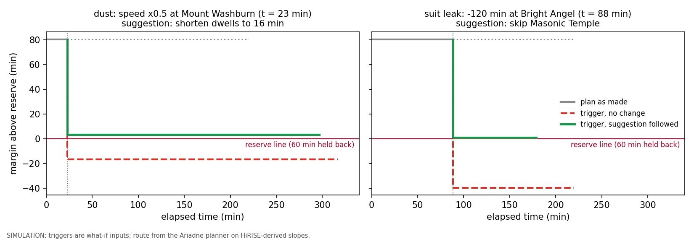

# Walk model

Owner: Bunyamin.

The walk model turns terrain slope into walking time. The planner uses it for routes and for the
return envelope. All numbers live in `model/params.json`; this page explains them. Every
parameter has a `provenance` and a `source` there.

## Parameters

| Parameter | Value | Provenance | Source | Carried over to Mars |
|---|---|---|---|---|
| `max_slope_deg` (no-go above) | 20 deg | Assumed | xEVA System Requirements Document (NASA 2021), quoted in Scoville, NTRS 20210026296 | Lunar suit requirement. Mars gravity is 2.3 times lunar gravity, so slopes are harder; 20 deg is a ceiling, not something to relax. |
| `caution_slope_deg` (caution above) | 15 deg | Assumed | Team choice, no source | Display class only; it does not change cost. |
| `walk_speed_flat_m_per_min` | 33.3 m/min (2 km/h) | Assumed | Del Greco et al. 2021, quoted in Scoville, NTRS 20210026296 | Lunar planning rate. Walking at 0.38 g is closer to Earth gait, so this is conservative. |
| `speed_vs_slope` | factor 1.0 / 0.736 / 0.539 / 0.391 / 0.28 at 0 / 5 / 10 / 15 / 20 deg | Modeled | Tobler 1993 hiking function, normalised | Earth, unsuited. Only the shape is used. |
| `dwell_min` per stop | 20 min | Derived | Median of nine Apollo 15 geology stations (12–65 min, median 21), from the Apollo 15 Activities Timeline (WUSTL) | Lunar station times; the time spent at a station does not depend on gravity as much as walking does. One value for every stop. |
| `budget_min` (planned EVA duration) | 360 min | Assumed | Artemis III SDT nominal EVA 6 ± 2 h; Mars PLSS study 6 h design case (NTRS 20210026296, 20260005204) | Planned duration, not the suit limit: the lunar suit requirement is at least 8 h plus 1 h contingency; no Mars suit exists yet, the Mars PLSS study covers 2–8 h. Show it as "planned EVA duration" in the UI. |
| `reserve_min` | 60 min | Assumed | Mars PLSS study (1 h secondary life support for 4-8 h EVAs); xEVA 1 h contingency | Contingency duration used as walk-home reserve, held inside the budget. |
| `radiation_dose_rate` | 210 uGy/day | Modeled | Hassler et al. 2014, Science 343, 1244797 (MSL RAD, Gale) | Measured at Gale; used as a model value for Jezero. |
| `observer_height_m` | 2.0 m | Observed | Bell et al. 2021, Space Sci. Rev. 217:24 (Mastcam-Z) | Rover camera height; no carry-over needed. |
| `replan_interval_min` | 5 min | Assumed | Team choice, no source | How often replanning re-checks the plan (see Replanning). |
| `min_dwell_min` | 10 min | Assumed | Team choice: half of `dwell_min`, no source | Shortest dwell replanning may suggest before it drops a stop. |

"Assumed" with a source means a published requirement or design case that we adopted; it is not a
measurement.

The nominal EVA of 6 ± 2 h is a range of planned EVA lengths, not uncertainty in suit endurance.
Uncertainty in consumption is covered by the 60 min reserve, by the suit requirement of at least
8 h (2 h above our plan) and by its 1 h contingency capability.

## How cost is computed

1. Slope per 2 m cell comes from the HiRISE DTM (task A3): the **mean** of the four 1 m Horn
   slopes in the cell. Taking the maximum instead picked up DTM noise: with the maximum, 3.1 % of
   Perseverance's track came out steeper than 20° (median track slope 11.5°, p95 19.2°); the mean
   lowers track slopes by about 1° (median 10.7°, p95 18.2°) and the no-go share of the track from
   3.1 % to 1.8 % (Ali Koray, PR #40). The 20° threshold itself stays, since it comes from the suit
   requirement, not from the data.
2. Cells steeper than `max_slope_deg` are impassable.
3. Speed = `walk_speed_flat_m_per_min` x `speed_vs_slope(slope)`, linear interpolation between pairs.
4. Cell cost = 1 / speed, in minutes per metre.
5. `cost_to_home` is one shortest-path run (Dijkstra, 8-connected) from the safe haven (task A4).
6. Margin at a cell = (`budget_min` - elapsed) - `reserve_min` - `cost_to_home`.

## Simplifications

- **Isotropic cost.** Cost does not depend on direction: walking up a slope costs the same as
  walking down it. This is what lets one run from the safe haven stand for the walk back to it.
  Tobler's function is asymmetric (fastest slightly downhill); we use it symmetric in slope.
- **Slope only.** No surface class (sand, rock fields) in the cost yet.
- **Lunar values on Mars.** Slope limit and flat speed come from lunar planning documents.
- **Earth curve.** The speed-vs-slope shape is from Earth hikers without a suit.
- **Radiation from Gale.** Jezero has no surface dose measurement.

## Why this site

Bright Angel, on the northern edge of Neretva Vallis in Jezero crater, holds the Cheyava Falls
rock and its Sapphire Canyon core: the strongest candidate for a sign of ancient life that
Perseverance has found (NASA, July 2024; Hurowitz et al. 2025, Nature). A robot found the clue; a
human geologist at the outcrop could test it. The rover's own route gives us real stops, real
photos and a traverse to validate against, all inside one 2.5 x 2 km area.

Stops (`content/stops/index.json`) are Perseverance's end-of-drive positions on the sol it arrived,
in the rover's order: Mount Washburn (sol 1162), Tuff Cliff (1168), Bright Angel (1175), Cheyava
Falls (1210; core on about sol 1215) and Masonic Temple (1231). Straight-line spacing along that
order is 118, 559, 153 and 401 m (1.23 km). Masonic Temple's sol is inferred from the Malgosa
Crest abrasion (sol 1242, Hurowitz et al. 2025); no NASA news page names it.

The safe haven is a spot where Perseverance parked on sol 1134 (waypoint 52_350), on the Margin
unit east of the channel, with a measured rover tilt of 4.5°, below the 15° caution slope. All
stops are 0.4–1.1 km from it. A straight-line tour haven → stops → haven is about 2.7 km; with 30 %
detour at 33.3 m/min plus five 20-minute dwells that is roughly 205 min, inside the 300 min left
after the reserve.

Both checks are now done on the real rasters. The haven's slope on the DEM is 4.9° (rover tilt
4.5°); every stop sits on a passable cell (Ali Koray, A4). With the 2 m slope as the mean of the 1 m
slopes (#40), the planner's route haven → five stops → haven is **2.89 km, 119.7 min walking + 100
min dwell = 219.7 min**, leaving **80.3 min** of the 300 min before the reserve (planner `/route`,
re-run in `notebooks/validation.ipynb` setup on bundle 20261114T1101Z). The earlier 224 min / 76 min
came from the maximum slope aggregation and is superseded.

## Budget check (synthetic)

On a synthetic 2.5 x 2 km site with five stops (sandbox, not real terrain) the plan ended at
t ≈ 279 min: about 179 min walking plus 100 min dwell. With 240 min budget and 60 min reserve the
astronaut could not get home; with 360 min the reserve stays intact. Repeat this check with the
real stops (B2) and the real cost raster (A4): the planned route must end before
`budget_min - reserve_min`.

## Replanning

Receding-horizon replanning re-checks the rest of the walk while it runs and suggests the smallest
change that still gets the astronaut home with the reserve intact. It is a **suggestion on the
console**: the crew decides, and the simulated astronaut does not follow it on its own.

**Triggers.** Two what-if controls on the console. Both are Simulation inputs, not measurements.

- **Suit leak:** `leak_min` comes off the consumables budget, so the deadline is
  `budget_min − leak_min − reserve_min`.
- **Dust / low visibility:** all walking time, the walk home included, is divided by `speed_factor`
  (0.5 = half speed); dwells do not change. Wind is modelled this way, not as a force on the
  astronaut: at Jezero's air density (about 0.018 kg/m³ from the sol 1215 MEDA pressure and
  temperature, our calculation) a 20 m/s wind pushes like a 2–3 m/s breeze on Earth.

**Definitions.** `D` is the time still needed: walking (what is left of the leg to the current stop,
the legs between the kept stops and the leg home) divided by `speed_factor`, plus the remaining
dwells; at the current stop only `max(0, new dwell − dwell already spent)` is left.
`margin = deadline − (t + D)`, and `reserve_left = reserve_min + margin` is the reserve on arrival
at the haven. Mid-leg, `lead_min` = leg time × remaining path length / leg path length.

**The rule, and why each line:**

1. Re-check every `replan_interval_min` (5 min), on arrival at each stop and when a trigger changes:
   often enough to react within one short leg, and at the moments the crew can act.
2. If `t + D ≤ deadline`, no suggestion: the 60 min reserve is already held back inside the deadline.
3. Otherwise shorten all remaining dwells equally, in 1 min steps from `dwell_min` (20) down to
   `min_dwell_min` (10), and take the longest that fits: every stop is kept and the plan changes least.
4. If that is not enough, drop one remaining stop, then two, and so on, trying every combination in
   plan order; dwells may be shortened too. Fewer stops is a bigger change than shorter stops.
5. Among plans that fit: most stops kept, then the longest dwell, then the larger margin, then the
   plan that keeps the earlier stops. Science first, then time at each stop, then safety; the last
   step makes the choice unique.
6. The stop being walked to is never dropped mid-leg: the planner routes from stop to stop, not from
   an arbitrary point.
7. If nothing fits, go home now along `cost_to_home` from the astronaut's position, divided by
   `speed_factor`. This is always possible; a negative margin means the reserve is in use.
8. Stops are never reordered: the order is the crew's plan; the rule only shortens or removes.
9. While a storm alert is active there is no suggestion: mission-control's abort already sends the
   astronaut home.

**Data.** Leg times come from the planner (`POST /route`, the existing contract): every pair of
stops in plan order, every haven → stop and stop → haven leg, fetched once into
`notebooks/out/route.json` with the planner commit. The running planner does not report its commit;
the planner code of that commit, run locally on the asset host's rasters, gave the same 21 answers.
`cost_to_home_2m.f32` equals the planner's walk home at all five stops.

**What it does on the real route** (`notebooks/replanning.ipynb`; all 11 cases in
`notebooks/out/replanning_cases.json`):

| Trigger | Where | Suggestion | Margin | Reserve left |
|---|---|---|---|---|
| none | Tuff Cliff | none | 80.3 min | 140.3 min |
| dust, speed × 0.5 | arrival at Mount Washburn | shorten dwells to 16 min | 3.3 min | 63.3 min |
| dust, speed × 0.4 | arrival at Mount Washburn | skip Masonic Temple | 6.5 min | 66.5 min |
| suit leak −90 min | arrival at Tuff Cliff | shorten dwells to 17 min | 2.4 min | 62.4 min |
| suit leak −120 min | arrival at Bright Angel | skip Masonic Temple | 1.0 min | 61.0 min |
| suit leak −150 min | arrival at Cheyava Falls | go home now | −9.0 min | 51.0 min |
| leak −150 min and speed × 0.5 | arrival at Cheyava Falls | go home now | −52.8 min | 7.3 min |

A speed factor of 0.6 alone or a 60 min leak alone does not trigger a suggestion at any stop
arrival: the plan has 80 min to spare. The rule takes the longest dwell that fits, so the margin
after a suggestion is small by design; the 60 min reserve is the safety, not that margin.

**Limits.** All stops weigh the same: the rule does not know that Cheyava Falls matters more than
the others. It changes which stops are visited and for how long, not the path: a suit fault that
lowers the slope limit would need a new cost raster and is not covered.

## Not yet verified

- Tobler 1993: citation written from memory; check the original report.
- Hassler et al. 2014: value read from a copy of the paper, not the Science page.
- Bell et al. 2021: "~2 m" read from a search excerpt of the paper; check the PDF.
- Apollo 15 timeline: the page credits "MSC-07230 Apollo 16 Mission Report"; check that the
  station times are Apollo 15's.
- `walk_speed_flat_m_per_min`: no measured suited walking speed on Mars exists; the lunar planning
  rate is used. Erring slow makes the envelope smaller than reality, which is the safe side.
