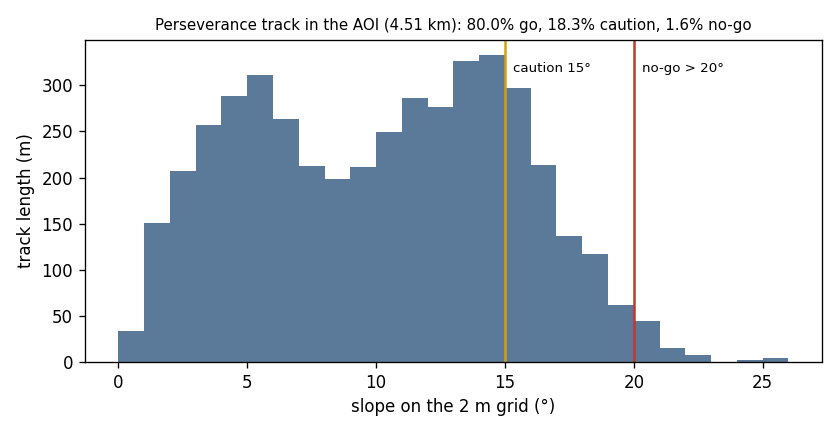
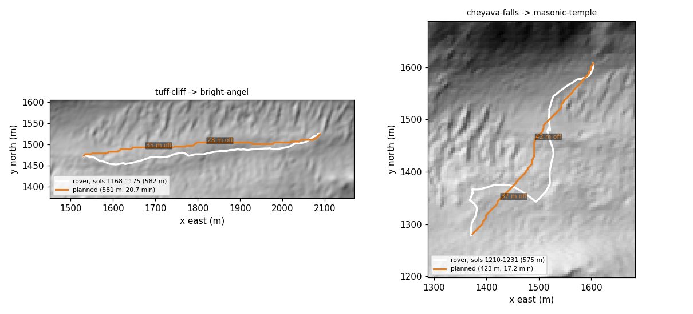

# Validation

Owner: Bunyamin.

How the walk model, the rasters and the conditions data were checked, with the script or notebook
that reproduces each check.

## Conditions: MEDA weather for sol 1215

Reproduce: `python notebooks/meda_sol.py --sol 1215` → `content/conditions/meda.json`.

Sol 1215 is the day the Sapphire Canyon core was taken at Cheyava Falls (July 21, 2024). The values
come from the Mars 2020 MEDA bundle on the NASA PDS Atmospheres Node (dataset doi:10.17189/1522849).

| Value | Sol 1215 | Product | Method |
|---|---|---|---|
| Air temperature, min | 192.0 K (−81.1 °C), at about 05:02 LMST | `CAL_ATS` (calibrated) | Median of the three mast sensors at each time step, then the minimum over the sol |
| Air temperature, max | 259.6 K (−13.6 °C), at about 15:50 LMST | `CAL_ATS` | Same median, maximum over the sol |
| Pressure, daily mean | 744.7 Pa (range 727.7–759.0 Pa) | `DER_PS` (derived) | Mean over the sol |
| Dust opacity | not available | — | The PDS bundle has no MEDA opacity product (RDS is calibrated irradiance only) |

- The two sensors on the rover body read up to 20 K warmer in the afternoon (279 K vs 252–264 K on
  the mast), so they are left out.
- The mast sensors themselves differ by up to 12 K at the daily maximum. The median of three is a
  simple, stated choice, not the MEDA team's own air-temperature product.
- Provenance is **Derived**: computed from Observed calibrated data by the method above.
- Checked: the object mission-control serves from this file (`provenance`, `source`, `source_url`,
  `mode: archive`, `sol`, `values`, `units`) validates against the `Weather` schema in
  `contracts/openapi.yaml`.

## A rover is not a human

The two checks below compare our map with ground Perseverance actually drove. A rover drives slopes
and rock a suited astronaut would avoid, and it avoids sand a human could cross. So these are
sanity checks of the DEM-derived slopes, the thresholds and the planner, **not proof** that the walk
is safe. Reproduce: `notebooks/validation.ipynb` (functions in `notebooks/validation.py`, tests in
`notebooks/test_validation.py`), on assets bundle 20261114T1101Z.

## Slope along the rover track

`slope_2m.f32` sampled every 0.5 m along Perseverance's track inside the AOI, weighted by path length.
Thresholds from `model/params.json`: caution from 15°, no-go above 20°.

| Track in the AOI | 4.51 km |
|---|---|
| Median slope | 10.5° |
| 95th percentile | 18.2° |
| Maximum | 25.2° |
| Go (< 15°) | 80.0 % of the length |
| Caution (15–20°) | 18.3 % |
| No-go (> 20°) | **1.6 %** |

- The 2 m slope is the mean of the four 1 m Horn slopes (decision 2026-11-14, `docs/model.md`).
  With the maximum instead, the no-go share was 3.1 %; Ali Koray's cell count with the mean gives
  1.8 %. Our 1.6 % weights by length along the track, which is the fairer measure for a path.
- 1.6 % no-go on a route a rover drove is plausible: the rover handles steeper ground than our 20°
  suit limit, and part of it is DTM noise at the 2 m scale. The threshold was not tuned to the data.
- The distribution has two peaks, near 5° (channel floor) and near 13–14° (margins and outcrop
  slopes). Most of the rover's driving sits below our caution slope.

## Planned route vs the rover's path

Planned legs come from the planner's own code (`planner/app`, least-cost path on `cost_2m.f32`)
between the same two waypoints the rover stopped at. "In model" is the walking time our cost model
gives for the rover's own path.

| Leg | Rover (sols) | Planned | Rover | Ratio | Planned time | Rover's path in our model | Rover path on no-go |
|---|---|---|---|---|---|---|---|
| Tuff Cliff → Bright Angel | 1168–1175 | 581 m | 582 m | 1.00 | 20.7 min | 23.4 min | 0 % |
| Cheyava Falls → Masonic Temple | 1210–1231 | 423 m | 575 m | 0.74 | 17.2 min | 25.7 min | 0 % |

- **Tuff Cliff → Bright Angel:** same length; the planned path runs up to 35 m north of the rover's
  for about 120 m in two stretches. NASA's account of the drive to Bright Angel mentions cutting
  across a 400 m dune field (NASA, June 13, 2024); we did not check whether this leg is part of
  it. Our cost model has no sand class either way. The near-equal length says the slope part of the
  model agrees with the drive.
- **Cheyava Falls → Masonic Temple:** our path is 26 % shorter and diverges up to 42 m. The rover's
  21 sols here include science stops and a loop to the south-west before Masonic Temple, so its path
  is not a point-to-point drive; the comparison mostly shows that our planner finds a direct
  passable line across the channel.
- In both legs the rover's own path is fully passable in our model (0 % on no-go cells), and our
  model rates it 2.7–8.5 min slower than the planned leg, as a least-cost planner should.

## What this does not show

- Walking speed and dwell are not checked: no suited walking on Mars exists to compare with.
- Surface class (sand, rock fields) is not in the cost; the dune shortcut above is the clearest case.
- The no-go share depends on the 2 m slope method and on DTM noise; the western AOI has striping.
